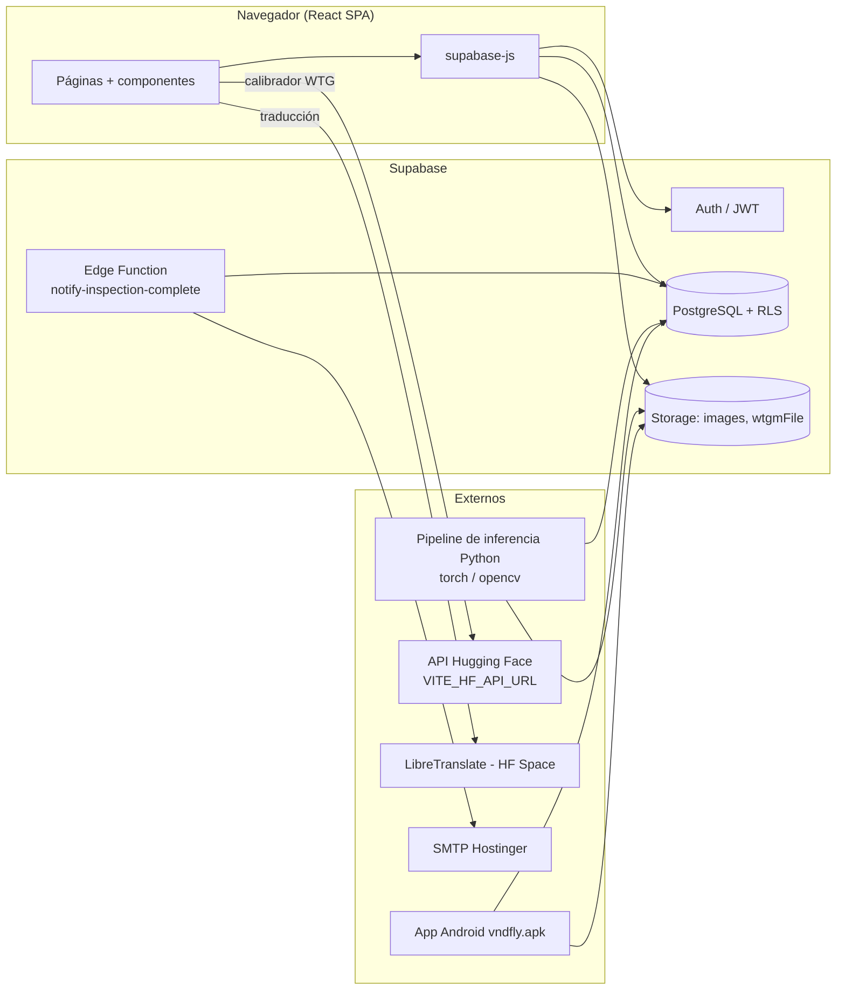
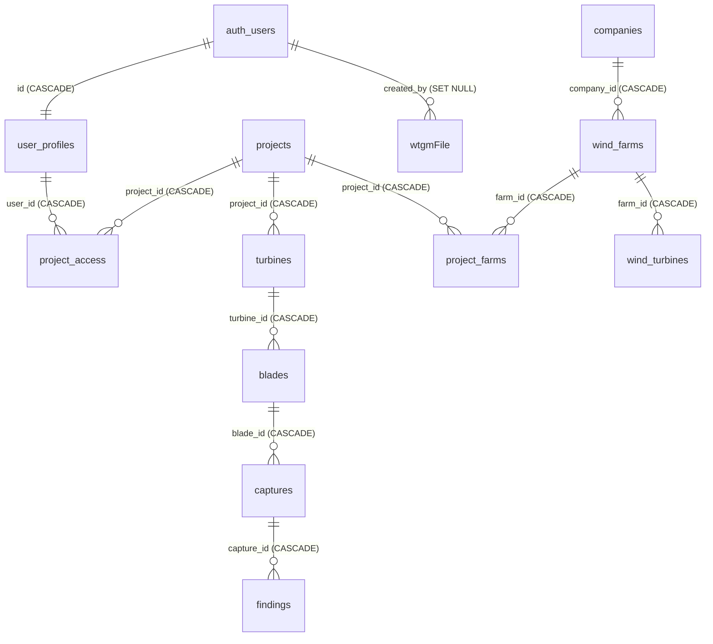
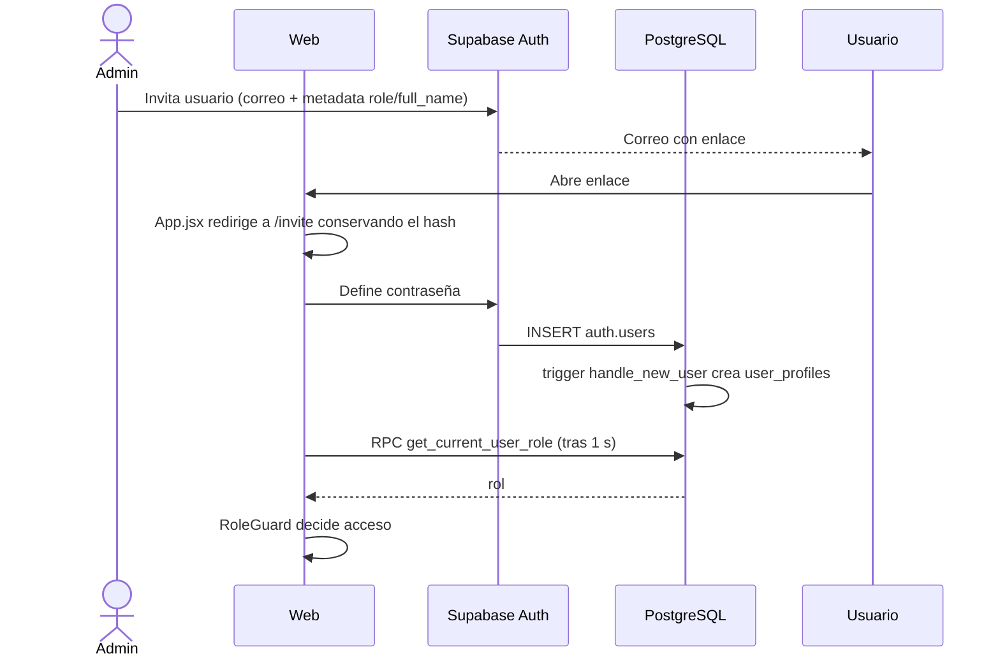
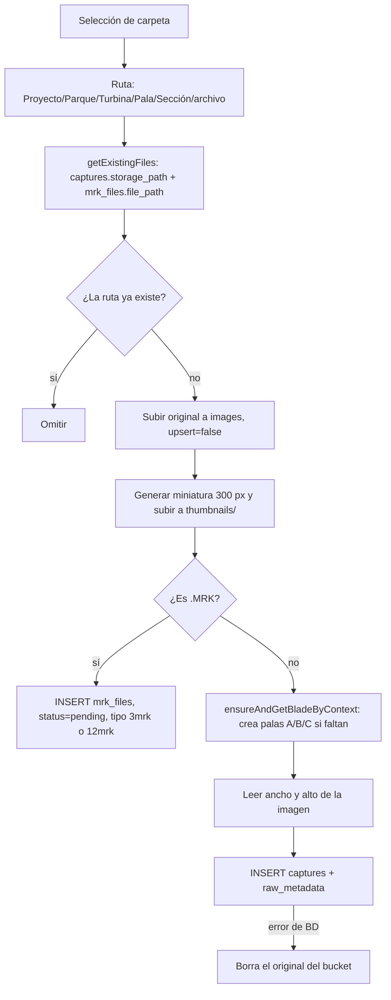

# VND Platform v2 — Documentación técnica

> **Producto:** VND Blade Platform (Vind Report Platform / Visus AI) · **Versión (`package.json`):** 2.1.0
> **Propósito:** gestión de inspecciones de palas de aerogeneradores (drones y LPS): carga de imágenes, detección de daños con IA, revisión humana, reconstrucción 3D, reportes PDF/DOCX y portal de cliente.
> **Fecha de esta revisión:** 2026-10-29

## Cómo leer este documento

Cada afirmación proviene del código fuente, de las migraciones SQL o de `contextwtgm.md`. Cuando algo **no se pudo verificar** (por ejemplo, el estado real de la base en producción, porque el conector de Supabase no estaba autorizado en esta sesión), aparece marcado como ⚠️ **No verificado** o en la sección [13. Deriva y riesgos](#13-deriva-entre-código-y-esquema-y-riesgos-detectados).

## Índice

1. [Visión general](#1-visión-general)
2. [Arquitectura](#2-arquitectura)
3. [Stack tecnológico](#3-stack-tecnológico)
4. [Estructura del repositorio](#4-estructura-del-repositorio)
5. [Autenticación, roles y permisos](#5-autenticación-roles-y-permisos)
6. [Base de datos](#6-base-de-datos)
7. [Almacenamiento (Storage)](#7-almacenamiento-storage)
8. [Módulos funcionales](#8-módulos-funcionales)
9. [Flujos de trabajo](#9-flujos-de-trabajo)
10. [Servicios e integraciones externas](#10-servicios-e-integraciones-externas)
11. [Configuración, build y despliegue](#11-configuración-build-y-despliegue)
12. [Desarrollo local y verificación](#12-desarrollo-local-y-verificación)
13. [Deriva entre código y esquema, y riesgos detectados](#13-deriva-entre-código-y-esquema-y-riesgos-detectados)
14. [Glosario](#14-glosario)

---

## 1. Visión general

La plataforma es una **SPA en React** que usa **Supabase** como backend completo (PostgreSQL, Auth, Storage, Edge Functions). No hay servidor de aplicación propio: el navegador habla directo con Supabase y las reglas de acceso viven en políticas RLS y funciones SQL.

Dos líneas de proyecto conviven, distinguidas por `projects.project_type`:

| Tipo | Valor | Descripción |
|---|---|---|
| Inspección con dron | `DRONE` (default) | Fotos por pala (A/B/C) y sección (LE/TE/SS/PS…). Detección de daños con ML, edición, reconstrucción y reporte. |
| LPS | `LPS` | Medición del sistema de protección contra rayos (milióhmetro). Los datos van en `turbines.lps_data` y los metadatos en `projects.lps_metadata`. Genera su propio PDF. |

Actores del sistema:

- **Técnico de campo** — sube imágenes desde la web (o desde la app Android `vndfly.apk`, ver `app-releases`).
- **Pipeline de IA** — proceso Python externo (`requirements_inference.txt`: torch, opencv, supabase) que lee `captures` sin procesar y escribe `findings`.
- **Administrador** — gestiona proyectos, usuarios, catálogos, traducción y el generador WTG.
- **Cliente** — consulta avance y reportes de los proyectos que tiene asignados.

---

## 2. Arquitectura



**Decisiones de diseño observables en el código**

1. **Cliente grueso, sin API propia.** Las consultas se arman en el frontend (`supabase.from(...)`), con encadenamientos manuales (turbinas → palas → capturas) en lugar de joins o vistas.
2. **Seguridad en la base.** RLS, funciones `SECURITY DEFINER` (`get_current_user_role`, `check_project_write_permission`, `update_user_role`) y un trigger que crea el perfil al registrarse un usuario.
3. **Progreso calculado en SQL.** `get_project_progress(p_project_id)` agrega secciones completas por turbina y pala.
4. **Datos semiestructurados en `jsonb`.** Telemetría, regiones de daño, atributos de IA, calibraciones y datos LPS se guardan como `jsonb` con índices GIN.
5. **Mínima superficie de servidor.** Solo existen una Edge Function y dos servidores Express auxiliares (SPA y traducción, ver [§11](#11-configuración-build-y-despliegue)).

---

## 3. Stack tecnológico

### Frontend

| Capa | Tecnología | Versión (`package.json`) |
|---|---|---|
| Framework | React | ^18.2.0 |
| Bundler | Vite + `@vitejs/plugin-react` | ^4.4.5 / ^4.0.3 |
| Lenguaje | JavaScript (JSX). Hay `@types/*` pero no hay `.ts`/`.tsx` en `src` | — |
| Ruteo | react-router-dom | ^6.16.0 |
| Estilos | Tailwind CSS + PostCSS + autoprefixer + `tailwindcss-animate` | ^3.3.3 |
| Componentes base | Radix UI (alert-dialog, avatar, checkbox, dialog, dropdown-menu, label, popover, select, slider, slot, tabs, toast) + `class-variance-authority`, `clsx`, `tailwind-merge` | varias |
| Iconos / animación | lucide-react, framer-motion | ^0.292.0 / ^10.18.0 |
| 3D | three (+ `@types/three`), decodificación Draco en `public/draco` | ^0.180.0 |
| Reportes | jspdf, html2canvas, docx, pdf-lib (build: pdfkit) | ^3.0.4 / ^1.4.1 / ^9.5.1 / ^1.17.1 |
| i18n | i18next + react-i18next (ES/EN) | ^25.4.2 / ^15.7.3 |
| Fechas | date-fns, react-day-picker | ^2.30.0 / ^8.9.1 |
| SEO | react-helmet | ^6.1.0 |
| Cliente backend | @supabase/supabase-js | ^2.55.0 |

### Backend (Supabase)

| Componente | Detalle |
|---|---|
| Base de datos | PostgreSQL 17 (`supabase/config.toml` → `major_version = 17`) |
| Auth | Email/contraseña, invitaciones y recuperación de contraseña vía enlaces con hash |
| Storage | Buckets `images` (inspecciones) y `wtgmFile` (privado, solo admin) |
| Edge Functions | Deno: `notify-inspection-complete` (SMTP vía `denomailer`) |
| API | PostgREST con `max_rows = 1000` (límite que el código esquiva paginando con `.range()`) |

### Servidor auxiliar y herramientas

| Elemento | Uso |
|---|---|
| Express + cors | `serve-spa.js` (SPA con fallback) |
| ESLint 8 + `eslint-config-react-app` | Lint |
| Terser | Minificación |
| ExifTool 13.42 (Windows, en `EXIF/`) | Extracción de metadatos DJI |
| Python | Inferencia de daños (`requirements_inference.txt`) y `requirements.txt` |
| Despliegue | Vercel (`vercel.json`) y/o Hostinger (`public/.htaccess`, ver `contextwtgm.md`) |

> No hay framework de pruebas configurado en `package.json`. Los archivos `test_*.js/.mjs/.cjs` de la raíz son scripts manuales (ver [§12](#12-desarrollo-local-y-verificación)).

---

## 4. Estructura del repositorio

```
VNDplatformv2/
├── src/
│   ├── main.jsx · App.jsx            Punto de entrada y tabla de rutas
│   ├── pages/                        Una página por ruta (ver §8)
│   │   └── wtgwtgmgenerator/         Calibrador WTG (app independiente + embebido)
│   ├── components/
│   │   ├── ui/                       Primitivas (button, dialog, select, toast…)
│   │   ├── damageEditor/ reportViewer/ reconstruction/ wtgm/ projects/
│   │   └── …                         Header, guards, visores 3D, ruler virtual, etc.
│   ├── contexts/LanguageContext.jsx  Idioma global
│   ├── hooks/                        useRolePermissions, useExifData, useBladeCalibration, useImageOptimization
│   ├── lib/                          supabase.js (cliente), utils.js (roles/rutas), wtgmStorage.js
│   ├── utils/                        smartUpload, blades, turbineProgress, deleteProjectCascade,
│   │                                 projectPermissions, projectFiltering, exifMeasurement,
│   │                                 lpsPdfGenerator, userManagement, dataSync, translationUtils
│   ├── services/                     libreTranslationService, hybridTranslationService, BladeManifestService
│   ├── api/heightNavigation.js       Navegación por altura relativa
│   ├── config/                       translationConfig
│   ├── i18n/ · locales/{es,en}/      common.json, reports.json
├── supabase/
│   ├── config.toml
│   ├── migrations/                   20261019150000_esquema.sql · 20261024120000_wtgm_file.sql
│   ├── functions/notify-inspection-complete/
│   ├── seeds/wtgm_catalog.sql
│   └── proposals/                    rls_01_policies.sql · rls_02_enable.sql · backfill_stitched_y_fecha.sql (NO aplicados)
├── scripts/                          delete-storage-folder.mjs · seed-wtgm-catalog.mjs
├── tools/                            generate-llms.js · post-build.js · setup-spa.js · generate-tools-pdf.js
├── plugins/ · middleware/            Plugins Vite y middleware SPA
├── EXIF/                             ExifTool para Windows
├── public/                           Modelos 3D (.glb), Draco, iconos, .htaccess
├── schemaDataBase.txt                Volcado de esquema antiguo (desactualizado, ver §13)
├── contextwtgm.md                    Bitácora del módulo Generador WTG
├── vercel.json · vite.config.js · tailwind.config.js · postcss.config.js
└── package.json · requirements*.txt
```

Alias de importación: `@/` apunta a `src/` (usado en todo el código).

---

## 5. Autenticación, roles y permisos

### 5.1 Roles

Enum de base de datos `access_role_enum`: `client`, `technician`, `admin`, `service_ai`.
El frontend (`src/lib/utils.js`) solo modela tres: `admin`, `technician`, `client`. `service_ai` existe para el pipeline de IA y se trata solo en SQL.

### 5.2 Rutas por rol (`ROLE_ACCESS`)

| Ruta | admin | technician | client | Notas |
|---|:-:|:-:|:-:|---|
| `/` Dashboard | ✔ | ✔ | ✔ | Las tarjetas cambian por rol (`getAllowedDashboardCards`) |
| `/projects` | ✔ | — | — | Alta y edición de proyectos |
| `/progress` | ✔ | ✔ | ✔ | Avance general |
| `/capture` | ✔ | ✔ | — | Carga de imágenes y proyectos LPS |
| `/reports-portal` | ✔ | ✔ | ✔ | Listado de reportes |
| `/report-viewer/:projectId/:turbineName` | ✔ | ✔ | ✔ | |
| `/report-editor/:projectId/:turbineId` | ✔ | ✔ | — | |
| `/damage-editor`, `/damage-editor-test` | ✔ | ✔ | `damage-editor` sí | El cliente solo ve daños |
| `/image-viewer` | ✔ | ✔ | ✔ | |
| `/wtg-generator` | ✔ | — | — | Doble protección: `ROLE_ACCESS` y `RoleGuard requiredRole="admin"` |
| `/admin` | ✔ | — | — | |
| `/login`, `/invite`, `/password-reset` | públicas | | | |

`canAccessPath(role, path)` acepta la ruta exacta o cualquier subruta (`/report-viewer/123/WTG01`).

### 5.3 Ciclo de sesión (`App.jsx`)

1. `supabase.auth.getSession()` al arrancar y suscripción a `onAuthStateChange`.
2. Si hay sesión se llama `fetchCurrentUserRole()` **con 1 s de retraso**, para dar tiempo al trigger que crea el perfil.
3. `fetchCurrentUserRole()` usa el RPC `get_current_user_role`; si falla, consulta `user_profiles`; si también falla, asume `client`.
4. Si el usuario del token ya no existe (`user_not_found`), cierra sesión y recarga.
5. Enlaces con `#type=invite|signup|recovery` o `#error=…` se redirigen a `/invite` conservando el hash.

> El rol por defecto ante cualquier error es `client` (fallo seguro: privilegio mínimo).

### 5.4 Alta de usuarios

`auth.users` → trigger → `handle_new_user()` inserta en `user_profiles` con el rol de `raw_user_meta_data->>'role'` (o `client` si es nulo o inválido). Si el insert falla, el usuario se crea igual y se emite un `WARNING`.

### 5.5 Acceso a proyectos

Hay **dos mecanismos** que conviene distinguir:

| Mecanismo | Dónde | Efecto |
|---|---|---|
| `project_access` (BD) | RLS + `check_project_write_permission` | Fuente de verdad real. Define quién ve y quién escribe. |
| Filtro por correo (frontend) | `src/utils/projectPermissions.js` | Compara el correo del usuario con `park_manager_email`, `technical_lead_email`, `review_personnel_email` y `staff`. Es solo experiencia de usuario, no seguridad. |

El trigger `trg_sync_project_relations` mantiene ambos alineados: al cambiar `client`, `wind_farm` o los tres correos de `projects`, recalcula `project_farms` e inserta filas en `project_access` para los usuarios cuyo correo coincide.

---

## 6. Base de datos

Esquema `public` en PostgreSQL 17. Fuente: `supabase/migrations/20261019150000_esquema.sql` y `20261024120000_wtgm_file.sql`.

### 6.1 Diagrama entidad-relación



Jerarquía de inspección: **proyecto → turbina → pala (A/B/C) → captura (imagen) → hallazgo (daño)**. Todas las claves foráneas son `ON DELETE CASCADE`, salvo `wtgmFile.created_by` (`SET NULL`).

### 6.2 Enumeraciones

| Enum | Valores |
|---|---|
| `access_role_enum` | `client`, `technician`, `admin`, `service_ai` |
| `blade_position_enum` | `A`, `B`, `C` |
| `capture_section_enum` | `LE`, `TE`, `SS`, `PS`, `Internal`, `Reference`, `Root`, `Tip` |
| `finding_severity_enum` | `1`, `2`, `3`, `4`, `5` |
| `finding_type_enum` | `damage`, `anomaly`, `maintenance`, `feature` |
| `sequence_direction_enum` | `RootToTip`, `TipToRoot`, `Unknown` |

`captures.section` es `text`, no usa `capture_section_enum`; `captures.sequence_dir` es `text` con valor por defecto del enum.

### 6.3 Tablas

#### Núcleo de inspección

**`projects`** — UNIQUE(`name`)

| Columna | Tipo | Notas |
|---|---|---|
| `id` | uuid PK | `gen_random_uuid()` |
| `name` | text | único |
| `client`, `wind_farm` | text | Nombres en texto; el trigger los cruza con `companies`/`wind_farms` |
| `status` | text | Default `'Planeación'` |
| `turbine_count` | int | Default 0 |
| `park_manager`, `technical_lead`, `contractor`, `review_personnel` | text | |
| `park_manager_email`, `technical_lead_email`, `review_personnel_email` | text | Disparan la sincronización de accesos |
| `start_date`, `end_date` | timestamptz | |
| `staff_list` | jsonb | Default `[]` |
| `turbine_model` | text | |
| `lps_metadata` | jsonb | Metadatos de proyecto LPS |
| `project_type` | text | Default `'DRONE'`; valor `'LPS'` para LPS |
| `created_at`, `updated_at` | timestamptz | `updated_at` por trigger |

**`turbines`** — UNIQUE(`project_id`, `turbine_name`) · índices: `project_id` (btree), `coordinates` (GIN)

| Columna | Tipo | Notas |
|---|---|---|
| `id`, `project_id` | uuid | FK a `projects` |
| `turbine_name` | text | |
| `status` | text | Default `'Pendiente'`; el código usa también `'Completado'` |
| `model`, `blade_length` | text / double | |
| `coordinates` | jsonb | |
| `inspection_date` | timestamptz | |
| `lps_data` | jsonb | Resultados de mediciones LPS |
| `id_image_path` | text | Imagen con el ID de la turbina |
| `stitched` | jsonb | Mosaicos por pala/sección y calibración compartida en `_calibration[pala][sección]`. El código también tolera que llegue como texto JSON. |

**`blades`** — UNIQUE(`turbine_id`, `position`) · índice `turbine_id`

| Columna | Tipo |
|---|---|
| `id` | uuid PK |
| `turbine_id` | uuid FK |
| `position` | `blade_position_enum` |
| `serial_number` | text |

**`captures`** — UNIQUE(`storage_path`) · índices: `blade_id`, `section`, `measured_at`, `telemetry` (GIN), parcial `id WHERE raw_metadata->'ai_processed' IS NULL`

| Grupo | Columnas |
|---|---|
| Identidad | `id`, `blade_id`, `storage_path` (ruta en el bucket `images`), `section` |
| GPS | `gps_lat`, `gps_lon`, `gps_alt` |
| Gimbal | `gimbal_pitch`, `gimbal_roll`, `gimbal_yaw` |
| Medición | `lrf_dist_m`, `calculated_height_m`, `mm_per_px` |
| Orden | `sequence_dir`, `measured_at` |
| Jsonb | `telemetry`, `raw_metadata` (nombre original, tamaño, tipo, marca `ai_processed`) |
| Auditoría | `created_at`, `updated_at` (trigger) |

El índice parcial sobre `ai_processed IS NULL` es la **cola de trabajo** del pipeline de IA: localiza rápido las capturas pendientes.

**`findings`** — índices: `capture_id`, `attributes` (GIN), `region` (GIN) · CHECK `confidence` ∈ [0, 1]

| Columna | Tipo | Contenido |
|---|---|---|
| `type` | `finding_type_enum` | Default `damage` |
| `severity` | `finding_severity_enum` | 1–5 (la UI la muestra como "Cat N") |
| `confidence` | double | 0–1 |
| `region` | jsonb | Modelo ML: `bbox_xywh_norm: [x,y,w,h]`. Edición manual: `{x,y,width,height}`. Ambos normalizados. |
| `attributes` | jsonb | `damage_type`, `radio`/`radius` (m; si >200 se asume mm), `width`/`length` (mm), `area` |
| `ai_metadata` | jsonb | Metadatos del modelo |

#### Control de acceso

**`user_profiles`** — `id` FK a `auth.users`: `email`, `full_name`, `avatar_url`, `role` (default `client`), `is_active` (default true).

**`project_access`** — PK compuesta (`project_id`, `user_id`) · `role` (default `client`) · `assigned_at` · índice (`user_id`, `project_id`).

#### Catálogos de parques

| Tabla | Columnas clave |
|---|---|
| `companies` | `id`, `name` UNIQUE |
| `wind_farms` | `id`, `company_id` FK, `name` UNIQUE |
| `wind_turbines` | `id`, `farm_id` FK, `name` (catálogo de máquinas del parque) |
| `project_farms` | PK (`project_id`, `farm_id`), puente proyecto ↔ parque |

#### Auxiliares

| Tabla | Descripción | Uso en `src` |
|---|---|---|
| `app-releases` | `version_code` (identity), `version_name`, `apk_url`, `release_notes`. Actualizaciones de `vndfly.apk`. | No se consulta desde la web |
| `pilots` | `name` PK, `license`, `flight_hours`, `email` UNIQUE. Pilotos RPAS. | No encontrado |
| `instruments` | `name` (default "Milióhmetro"), `serial_number` UNIQUE, `calibration_date`, `certificate_url`, `is_active`. | No encontrado |

#### Generador WTG

**`"wtgmFile"`** (nombre con comillas y camelCase) — calibraciones guardadas.

| Grupo | Columnas |
|---|---|
| Control | `id` (generado en cliente), `created_at`, `updated_at` (trigger), `created_by` (default `auth.uid()`) |
| Turbina | `wind_farm`, `manufacturer`, `wtg_model`, `tower_height_m`, `rotor_diameter_m`, `blade_length_m`, `blade_length_ref`, `axis_source`, `turbine_code`, `power_rating`, `missing_fields text[]` |
| Fotos | `photo{1,2}_path`, `_name`, `_width`, `_height` |
| Resultado | `keypoints`, `geometry`, `uncertainty`, `wtgm` (jsonb), `method`, `sigma_px` |

Índice `created_at DESC`. El catálogo inicial (5 modelos: V90, AW-125/3000, AW132, G145, G80) se carga con `supabase/seeds/wtgm_catalog.sql`, generado por `scripts/seed-wtgm-catalog.mjs`.

### 6.4 Funciones y triggers

| Objeto | Tipo | Qué hace |
|---|---|---|
| `get_current_user_role()` | función, SECURITY DEFINER | Rol del usuario en sesión; ante error devuelve `client` |
| `check_project_write_permission(p_id)` | función, SECURITY DEFINER | `true` si el usuario figura en `project_access` del proyecto con rol `technician`, `admin` o `service_ai` |
| `update_user_role(target, new_role)` | función, SECURITY DEFINER | Cambia el rol; lanza excepción si quien llama no es admin |
| `handle_new_user()` | trigger de `auth.users` | Crea el `user_profiles` |
| `sync_project_relations()` | trigger `trg_sync_project_relations` (AFTER INSERT/UPDATE de `client`, `wind_farm`, `*_email`) | Rehace `project_farms` y agrega accesos por correo |
| `update_updated_at_column()` | trigger | Mantiene `updated_at` en `projects`, `captures`, `findings` y `wtgmFile` |
| `rls_auto_enable()` | event trigger | Activa RLS automáticamente en tablas nuevas de `public` |
| `get_project_progress(p_project_id)` | función SQL | Ver abajo |

#### `get_project_progress`

Devuelve por turbina: `completed_sections`, `total_images` y `blade_sections` (jsonb con las secciones completas de cada pala). Una sección cuenta como **completa** solo si tiene inicio y fin:

- **Inicio:** archivo terminado en `_START.JPG` o `_S.JPG`, o el primero por orden alfabético de ruta.
- **Fin:** archivo terminado en `_END.JPG` o `_E.JPG`, o el último por orden alfabético.

Consecuencia: una sección con una sola imagen se considera completa (la misma imagen es inicio y fin).

### 6.5 Políticas RLS aplicadas (según la migración)

| Tabla | Operación | Condición |
|---|---|---|
| `projects` | SELECT | Existe fila en `project_access` para el usuario |
| `projects` | INSERT | Cualquier `authenticated` ⚠️ (incluye clientes) |
| `projects` | UPDATE / DELETE | `check_project_write_permission(id)` |
| `turbines`, `blades`, `captures`, `findings` | SELECT | Acceso al proyecto padre vía `project_access` |
| `turbines`, `blades`, `captures`, `findings` | ALL (escritura) | `check_project_write_permission` del proyecto padre |
| `project_access` | SELECT | `auth.uid() = user_id` |
| `user_profiles` | SELECT / UPDATE | Solo el propio perfil |
| `wind_farms`, `wind_turbines` | SELECT | Proyecto asignado con ese parque |
| `pilots` | SELECT | Correo del JWT = `pilots.email` |
| `project_farms` | — | RLS **activado**, sin políticas en la migración |
| `"wtgmFile"` | ALL | `get_current_user_role() = 'admin'` |

⚠️ La migración **solo ejecuta `ENABLE ROW LEVEL SECURITY` sobre `project_farms`** (y sobre `wtgmFile` en la segunda migración). Las demás tablas tienen políticas, pero las políticas no se aplican hasta que se active RLS. Ver [§13](#13-deriva-entre-código-y-esquema-y-riesgos-detectados).

### 6.6 Propuestas de RLS (no aplicadas)

`supabase/proposals/` contiene un plan por etapas, sin aplicar:

1. **`rls_01_policies.sql`** (seguro de ejecutar con RLS aún apagado): crea `is_admin()` e `is_staff()`, hace que `check_project_write_permission` reconozca al admin sin fila en `project_access`, restringe la creación de proyectos a admins, impide que un usuario se asigne `admin` a sí mismo (revoca `UPDATE` general sobre `user_profiles` y concede solo `full_name`, `avatar_url`, `is_active`), y agrega políticas de gestión para catálogos.
2. **`rls_02_enable.sql`**: activa RLS en tres etapas (A catálogos, B usuarios y accesos, C datos de inspección), con prueba por rol entre etapas.
3. **`backfill_stitched_y_fecha.sql`**: relleno de datos de `turbines.stitched` e `inspection_date`.

---

## 7. Almacenamiento (Storage)

| Bucket | Acceso | Contenido | Rutas |
|---|---|---|---|
| `images` | Se lee con `getPublicUrl` ⇒ se asume público ⚠️ | Fotos de inspección, miniaturas y archivos `.MRK` | `Proyecto/Parque/Turbina/Pala/Sección/archivo.jpg` |
| `wtgmFile` | Privado, solo admin (RLS en `storage.objects`: select/insert/update/delete) | 2 fotos por calibración | `<id>/photo1_<nombre>` y `<id>/photo2_<nombre>` |

Convenciones del bucket `images`:

- La ruta completa coincide con `captures.storage_path` (UNIQUE) y es el criterio de deduplicación.
- Miniaturas: `…/<Sección>/thumbnails/<archivo>.jpg`, JPEG de ancho máximo 300 px y calidad 0.7. Se pueden sobrescribir (`upsert: true`); el original no (`upsert: false`).
- `Cache-Control` de 15 552 000 s (180 días).

---

## 8. Módulos funcionales

| Módulo | Archivo(s) principal(es) | Responsabilidad |
|---|---|---|
| Login / invitación / reseteo | `LoginPage`, `InvitePage`, `PasswordResetPage` | Autenticación y activación de cuentas |
| Dashboard | `DashboardPage` | Tarjetas por rol; distingue iconografía DRONE y LPS |
| Proyectos | `ProjectsPage`, `components/projects/formKit`, `DeleteProjectDialog` | Alta/edición (compañía → parque en catálogos), asignación de personal, borrado en cascada |
| Captura de datos | `DataCapturePage`, `utils/smartUpload`, `utils/blades`, `ImageLoadingStats` | Carga masiva con deduplicación; también crea y edita proyectos LPS |
| Progreso | `GeneralProgressPage`, `utils/turbineProgress` | Avance por proyecto/turbina vía `get_project_progress`; en LPS cuenta como avanzada la turbina con `lps_data` no vacío |
| Visor de imágenes | `ImageViewerPage`, `components/VirtualBladeRuler`, `hooks/useBladeCalibration`, `hooks/useExifData` | Navegación por pala/sección, calibración, mosaicos (`turbines.stitched`) |
| Editor de daños | `DamageEditorPage`, `components/damageEditor/panels`, `DetectionEditModal`, `BladeModelViewer` | Revisión y edición de `findings` sobre la imagen; catálogo de tipos de daño por zona (borde de ataque/salida, rayos, conchas/coat, SAR) con traducción ES→EN integrada |
| Reconstrucción | `components/reconstruction/{ReconstructionPanel, RotorDamageMap3D, BladeFacesMap}`, `TurbineBlade3DModel` | Mapa 3D del rotor y mapa por caras de pala con daños por severidad; reloj de palas A=12 h, B=4 h, C=8 h |
| Reportes (editor) | `ReportEditorPage`, `ReportGenerator`, `ReportPreview` | Composición del reporte |
| Reportes (visor) | `ReportViewerPage`, `components/reportViewer/{viewerKit, ImageCarousel}`, `LanguagePdfDialog` | Visualización y exportación PDF/DOCX; elección de idioma |
| LPS | `LpsReportViewer`, `utils/lpsPdfGenerator` | Edición de `lps_data` y PDF de LPS |
| Portal de reportes | `ReportsPortalPage` | Listado de turbinas con reporte |
| Administración | `AdminPage`, `UserManagement`, `utils/userManagement` | Usuarios y roles (RPC `update_user_role`), configuración de traducción |
| Generador WTG | `WtgGeneratorPage`, `pages/wtgwtgmgenerator/*`, `components/wtgm/*`, `lib/wtgmStorage` | Solo admin. Ver [§9.7](#97-generador-wtg-wtgm) |
| Traducción | `services/{libre,hybrid}TranslationService`, `config/translationConfig` | ES/EN con LibreTranslate y respaldo local |

### Medición real desde EXIF (`utils/exifMeasurement.js`)

`calculateRealScale()` estima **mm/píxel** con una jerarquía de fuentes para la distancia al objetivo:

| Prioridad | Fuente | Confianza |
|---|---|---|
| 1 | `LRFTargetDistance` (telémetro láser, Matrice 4E) | alta |
| 2 | `RelativeAltitude / cos(pitch del gimbal)` | media |
| 3 | `FocusDistance` (conversión de unidad heurística) | baja |
| — | Sin EXIF: 0.1 mm/px por defecto | baja |

Usa `CalibratedFocalLength` (en píxeles) cuando existe. ExifTool (`EXIF/`) y el script de inferencia llenan `captures.gps_*`, `gimbal_*`, `lrf_dist_m`, `mm_per_px` y `calculated_height_m`.

---

## 9. Flujos de trabajo

### 9.1 Alta de usuario e inicio de sesión



### 9.2 Creación de un proyecto

1. Un admin crea el proyecto en `/projects` eligiendo compañía y parque de los catálogos.
2. Al guardar, `trg_sync_project_relations` vincula `project_farms` por nombre normalizado (`lower(trim())`) y crea `project_access` para los correos de gerente, líder técnico y revisión que ya tengan cuenta.
3. Las turbinas se registran con nombre único por proyecto.

> Si el nombre de compañía o de parque escrito en el proyecto no coincide exactamente con el catálogo, **no se crea el vínculo** y el cliente no verá nada.

### 9.3 Carga de imágenes (`smartUpload`)



Detalles relevantes:

- Procesamiento en **bloques de 5** archivos en paralelo con `Promise.allSettled`; el avance incluye los omitidos.
- La deduplicación compara la **ruta completa**, de modo que el mismo nombre en turbinas distintas no colisiona.
- Si ya existe el archivo en el bucket, se continúa y solo se registra en BD.
- Etiqueta de pala: `normalizeBladeLabel` acepta "a", "blade a", "pala a", "blade_a"…; si no reconoce nada, **asume la pala A**.
- Formato `.MRK`: si la carpeta contiene una sección (TE/PS/LE/SS) es `12mrk`; si está en la raíz de la pala es `3mrk`.
- El cálculo de dimensiones se hace en el navegador; el resto de metadatos EXIF los completa el pipeline.

### 9.4 Inferencia de daños (pipeline externo)

El código Python del modelo **no está en este repositorio**; solo sus dependencias (`requirements_inference.txt`). Del esquema y del cliente se deduce el contrato:

1. Selecciona `captures` con `raw_metadata->'ai_processed' IS NULL` (índice parcial dedicado).
2. Extrae EXIF y completa `gps_*`, `gimbal_*`, `lrf_dist_m`, `mm_per_px`, `calculated_height_m`, `telemetry`.
3. Detecta daños y escribe `findings` con `region.bbox_xywh_norm`, `severity`, `confidence`, `attributes` y `ai_metadata`.
4. Marca `raw_metadata.ai_processed`.
5. Opera con el rol `service_ai` (autorizado a escribir según `check_project_write_permission`).

Cuando una turbina queda completa (3 palas y todas sus secciones), la Edge Function `notify-inspection-complete` avisa por correo a los administradores. ⚠️ **No se encontró en `src/` ninguna llamada a esa función**; se invoca desde otro componente (webhook de BD, el pipeline o la app Android).

### 9.5 Revisión y edición de daños

1. El usuario abre `/damage-editor` con proyecto, turbina y sección.
2. Las imágenes se leen de `captures` (con miniaturas del bucket) y los daños de `findings`.
3. El editor interpreta ambos formatos de `region` (ML y manual) y las métricas de `attributes`.
4. Al editar se hace `update`/`insert`/`delete` sobre `findings`; RLS exige rol de escritura en el proyecto.
5. Los tipos de daño provienen de un catálogo fijo en `DamageEditorPage.jsx` (`DAMAGE_TYPES`), con traducción al inglés en `DAMAGE_TRANSLATIONS_EN`.

### 9.6 Reporte

1. `ReportViewerPage` consulta turbina, palas, capturas y hallazgos.
2. Usa el módulo de reconstrucción para mapas de daños.
3. Exporta a **PDF** (`jspdf` + `html2canvas`) o **DOCX** (`docx`); el idioma se elige en `LanguagePdfDialog` y la traducción pasa por LibreTranslate.
4. Para LPS el reporte lo genera `lpsPdfGenerator` desde `turbines.lps_data` y `projects.lps_metadata`.

### 9.7 Generador WTG (`.wtgm`)

Solo administradores. Dos pestañas en `/wtg-generator`:

| Pestaña | Función |
|---|---|
| **Calibraciones guardadas** (default) | Lista desde `wtgmFile`, filtros por modelo, **Generar .wtgm** (descarga el documento guardado) y **Editar** (datos de turbina y 11 valores de geometría) |
| **Nueva calibración** | Calibrador montado de forma persistente (no pierde fotos ni marcas al cambiar de pestaña) |

Flujo de una calibración nueva:

1. Se cargan 2 fotos (Foto 1: góndola → punta de pala; Foto 2: góndola → cimentación).
2. Un diálogo pide 6 datos (parque, fabricante, modelo, altura de torre, diámetro de rotor, longitud de pala) y avisa de los faltantes; sin longitud de pala no se calcula.
3. El usuario marca puntos; el cálculo de geometría usa `VITE_HF_API_URL` (API alojada en Hugging Face) y `wtgGeometry.js`/`wtgmFormat.js` para los 11 valores y el documento con checksum.
4. **Guardar** sube las fotos al bucket privado y hace `upsert` en `wtgmFile`; si falla, borra lo recién subido.
5. Al editar valores, `method` pasa a `'edited'`, se anula su incertidumbre y se eliminan los avisos de "valor genérico".

El calibrador también corre como app independiente (`pages/wtgwtgmgenerator/src/main.jsx`, con su propio `package.json` y `vite.config.js`) sin diálogo ni guardado.

### 9.8 Eliminación de un proyecto

`deleteProjectCascade` borra **desde el cliente**, en este orden: turbinas → palas → rutas de captura → `findings` → `captures` → `blades` → `turbines` → `projects` y, por último, los archivos del bucket `images`. Como las claves foráneas ya son `CASCADE`, el borrado manual existe sobre todo para recolectar las rutas del bucket y reportar progreso.

---

## 10. Servicios e integraciones externas

| Servicio | Uso | Configuración |
|---|---|---|
| **Supabase** | Auth, BD, Storage, Edge Functions | `VITE_SUPABASE_URL`, `VITE_SUPABASE_ANON_KEY` |
| **LibreTranslate (Hugging Face Space)** | Traducción ES↔EN de reportes, llamada directo desde el navegador | `VITE_LIBRETRANSLATE_URL`, `VITE_LIBRETRANSLATE_TOKEN` (opcional) |
| **Hugging Face (API propia)** | Cálculo del calibrador WTG | `VITE_HF_API_URL` |
| **SMTP Hostinger** | Correo de inspección completada | Secretos de la Edge Function: `SMTP_HOSTNAME`, `SMTP_PORT`, `SMTP_USERNAME`, `SMTP_PASSWORD`, más `SUPABASE_URL` y `SUPABASE_SERVICE_ROLE_KEY` |
| **App Android `vndfly.apk`** | Captura en campo; versiones en `app-releases` | — |

### Edge Function `notify-inspection-complete`

- **Entrada:** `POST { "turbineId": "<uuid>" }`.
- **Proceso:** lee la turbina y su proyecto con la clave de servicio, obtiene los correos de todos los `user_profiles` con rol `admin` y envía una plantilla HTML a cada uno (asunto "Inspección Completada: Turbina …").
- **Respuestas:** `200 { success, notified }`, `200 { message }` si no hay admins, `400 { error }`.
- **CORS:** `Access-Control-Allow-Origin: *`.

---

## 11. Configuración, build y despliegue

### Variables de entorno

Solo se usan las que empiezan por `VITE_` en el cliente. Se leen de `.env.local` (no versionado):

| Variable | Obligatoria | Comentario |
|---|:-:|---|
| `VITE_SUPABASE_URL` | Sí | Si falta usa un placeholder y la app no conecta |
| `VITE_SUPABASE_ANON_KEY` | Sí | Clave pública (anon) |
| `VITE_LIBRETRANSLATE_URL`, `VITE_LIBRETRANSLATE_TOKEN` | No | Traducción; ⚠️ cualquier `VITE_*` queda dentro del bundle público |
| `VITE_HF_API_URL` | Para el generador WTG | |

### Scripts de `package.json`

| Comando | Acción |
|---|---|
| `npm run dev` | Vite en modo desarrollo |
| `npm run dev:spa` | Vite con `--host 0.0.0.0` |
| `npm run build` | `tools/generate-llms.js` (tolerante a fallo) → `vite build` → `tools/post-build.js` |
| `npm run preview` | Sirve `dist` con Vite |
| `npm run serve` | `serve-spa.js` (Express con fallback a `index.html`) |
| `npm run test:spa` | `test-spa.js` (verifica el servidor SPA) |

### Despliegue

- **Vercel:** `vercel.json` reescribe todas las rutas a `/index.html` (SPA).
- **Hostinger:** `public/.htaccess` sirve el HTML con `no-cache` y cachea solo `/assets/` (hash en el nombre). Se corrigió porque antes el CDN guardaba `index.html` 7 días (`s-maxage=604800`) y las secciones nuevas no aparecían tras publicar.
- **Vite en desarrollo:** inyecta manejadores de errores que reportan al `window.parent` (`postMessage`).

### Supabase

```bash
supabase link --project-ref <ref>       # el ref está en supabase/.temp/project-ref
supabase db push                        # aplica supabase/migrations/*
supabase functions deploy notify-inspection-complete
supabase secrets set SMTP_USERNAME=… SMTP_PASSWORD=… SMTP_HOSTNAME=… SMTP_PORT=465
```

Puertos locales (`config.toml`): API 54321, BD 54322, shadow 54320.

---

## 12. Desarrollo local y verificación

```bash
npm install
# crear .env.local con las variables de la §11 (no hay .env.example en el repo)
npm run dev
```

Comprobaciones recomendadas antes de cerrar un cambio (según `CLAUDE.md` del proyecto):

```bash
npm run lint && npm run test -- --run && npm run build
npm audit --audit-level=high
```

Estado real: `package.json` **no define** los scripts `lint` ni `test`, así que esos dos comandos fallarán hasta que se agreguen. Solo `npm run build` está disponible hoy. Los `test_*.js` de la raíz (`test_all`, `test_db`, `test_db2`, `test_progress`, `test_supabase`) son scripts de diagnóstico manuales contra Supabase, no una suite automatizada.

Otras notas operativas:

- `repomix.config.json` está corrupto (error de sintaxis JSON5 en 1:1). Para empaquetar el contexto con Repomix hay que pasar `-c` con un archivo válido o repararlo.
- La raíz contiene artefactos que no deberían versionarse: ~40 archivos `vite.config.js.timestamp-*.mjs`, `backend_chord_debug.log`, `manifest_error_log.txt`, `output.json`, `__pycache__/`, `venv/`, `out/`, `dist/`, `graphify-out/`. Conviene añadirlos a `.gitignore`.

---

## 13. Deriva entre código y esquema, y riesgos detectados

### 13.1 El código usa objetos que la migración no define

| Hallazgo | Evidencia | Impacto |
|---|---|---|
| `blades.blade_name` | `utils/blades.js` lee/inserta `blade_name`; el esquema tiene `position` (enum) | Con el esquema de la migración, `ensureDefaultBlades` falla. Hay que confirmar cuál es la columna real en producción. |
| `captures.image_width`, `image_height` | `smartUpload.js` los inserta | No existen en la migración |
| Tabla `mrk_files` | `smartUpload.js` | Sin definición en migraciones |
| Tabla `image_navigation` y `inspection_files` | `api/heightNavigation.js`, `utils/navigationUtils.js` | Parecen del modelo V1; sin definición. Navegación por altura potencialmente rota |
| Tabla `damages` | `ReportEditorPage.jsx` | Modelo anterior a `findings`; sin definición |
| RPC `get_user_with_role` | `utils/userManagement.js` | Sin definición |
| `schemaDataBase.txt` | Volcado antiguo sin `lps_*`, `stitched`, catálogos ni `ON DELETE CASCADE` | No usarlo como referencia |

Posibles causas: el esquema se capturó con `supabase db dump` y la producción tiene cambios hechos desde el panel, o hay código del modelo V1 sin migrar. ⚠️ **No verificado contra la base viva.**

### 13.2 Seguridad

| # | Severidad | Hallazgo | Recomendación |
|---|---|---|---|
| 1 | **Alta** | La migración solo activa RLS en `project_farms` y `wtgmFile`; el resto de las tablas tienen `GRANT ALL` a `anon` y `authenticated`. Si RLS está apagado en producción, cualquiera con la clave anon (pública en el bundle) puede leer y escribir proyectos, perfiles y capturas. | Confirmar en el panel (`pg_class.relrowsecurity`) y aplicar `proposals/rls_01_policies.sql` y luego `rls_02_enable.sql` por etapas. |
| 2 | **Alta** | `user_profiles` permite `UPDATE` del propio registro incluyendo `role`: un usuario puede volverse `admin`. | Aplicar el `REVOKE/GRANT` por columnas de la propuesta `rls_01`. |
| 3 | **Alta** | Edge Function sin verificación de identidad, CORS abierto y clave de servicio: cualquiera que conozca la URL puede disparar correos a todos los admins con un `turbineId` válido. | Exigir JWT de usuario o un secreto compartido; limitar CORS. |
| 4 | Media | `INSERT` en `projects` permitido a cualquier autenticado, incluidos clientes. | Restringir a admin (propuesta `rls_01`). |
| 5 | Baja | `VITE_LIBRETRANSLATE_TOKEN` (si se usa) viaja en el bundle; el Space es público y cualquiera puede llamarlo. | Limitar `ALLOWED_ORIGINS` en el Space; el token solo es un freno básico. |
| 6 | Media | Bucket `images` servido con URLs públicas: las fotos de inspección son accesibles por cualquiera que tenga la ruta. | Pasar a bucket privado con URLs firmadas si las imágenes son confidenciales. |
| 7 | Baja | Funciones `SECURITY DEFINER` sin `SET search_path` fijo (`check_project_write_permission`, `get_current_user_role`, `update_user_role`). | Fijar `search_path = public`. |
| 8 | Baja | `get_current_user_role()` devuelve `client` ante cualquier excepción; es seguro, pero oculta fallos. | Registrar el error. |

### 13.3 Robustez y mantenimiento

- **Rol con retraso fijo de 1 s** en `App.jsx`: arreglo temporal para la carrera con el trigger de perfil; durante ese lapso el rol es `null`.
- **Borrado en cascada en el cliente** (`deleteProjectCascade`): no es transaccional; un fallo a mitad deja el bucket y la BD desalineados.
- **Consultas encadenadas** (turbinas → palas → capturas) con `.in(...)` de listas largas y paginación manual a 1000: candidatas a una vista o RPC. `max_rows = 1000` obliga a paginar.
- **Pala por defecto `A`** cuando el nombre no es reconocible: puede asignar fotos a la pala equivocada sin avisar.
- **Documentación previa desactualizada:** `README.md` indica versión 2.0.1 (el paquete es 2.1.0) y no cubre editor de daños, reconstrucción, WTG ni LPS. Además describe una carpeta `src/docs/` que no existe en el repositorio.
- **Migraciones con fecha futura** (`20261019…`, `20261024…`): consistentes entre sí, pero conviene revisar el reloj del entorno que las generó.
- **Pendientes del módulo WTG** (de `contextwtgm.md`): probar que técnico y cliente no leen la tabla ni el bucket, verificación visual responsive, y no se ejecutaron lint ni pruebas.

---

## 14. Glosario

| Término | Significado |
|---|---|
| **WTG** | Wind Turbine Generator, aerogenerador |
| **LE / TE / SS / PS** | Leading Edge (borde de ataque, BA), Trailing Edge (borde de salida, BS), Suction Side (concha de succión), Pressure Side (concha de presión) |
| **Pala A/B/C** | Posiciones de pala; en la reconstrucción se asocian a 12 h, 4 h y 8 h |
| **LPS** | Lightning Protection System, sistema de protección contra rayos |
| **SAR** | Sistema de captación y derivación de rayos de la pala |
| **MRK** | Archivo de marcas de posición del dron (3mrk por pala, 12mrk por sección) |
| **LRF** | Laser Range Finder, telémetro del dron |
| **mm/px** | Escala real de la imagen según distancia y focal |
| **Finding** | Hallazgo/daño detectado o añadido manualmente |
| **RLS** | Row Level Security de PostgreSQL |
| **`.wtgm`** | Documento de geometría de turbina generado por el calibrador, con checksum |
| **Cat 1–5** | Severidad de daño mostrada en la interfaz |
